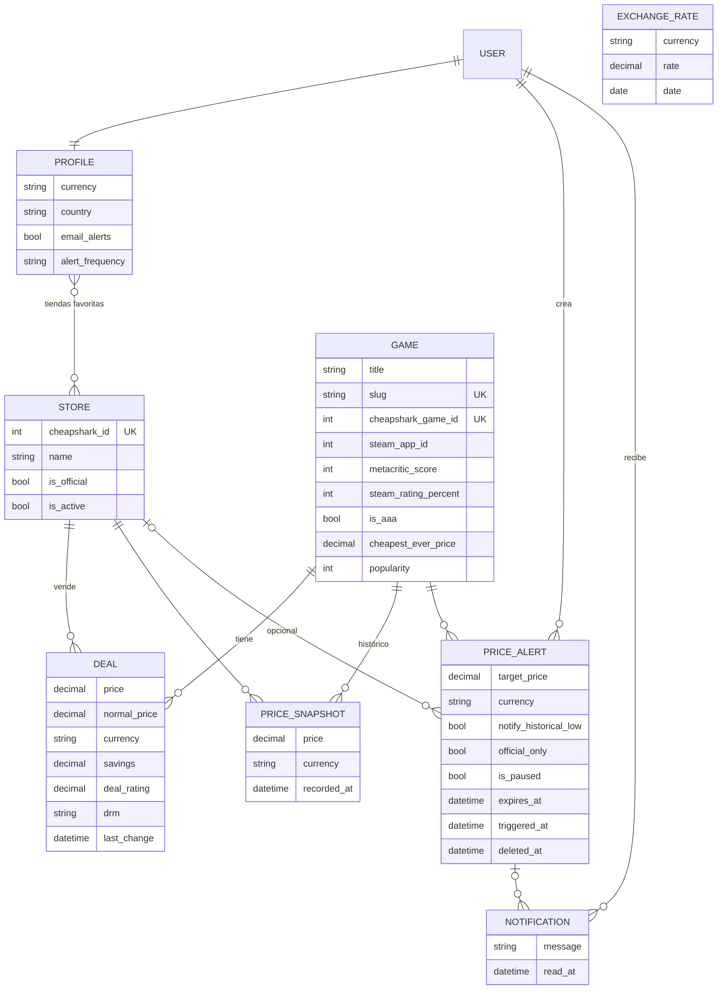

# PriceWatch

Comparador de precios de juegos para PC. Muestra el precio de cada juego en varias tiendas (Steam, GOG, Epic, Humble, Fanatical…), guarda el histórico, convierte los precios a la moneda de cada usuario y avisa por correo cuando un juego baja del precio que hayas elegido.

**Stack:** Python 3.13 · Django 5.1 · PostgreSQL 16 · htmx · django-allauth · Docker · Render + Neon

## Funcionalidades

- **Buscador en vivo** en la portada (htmx) y búsqueda completa en la pestaña Juegos.
- **Categorías** basadas en los filtros de la API de CheapShark: mejores ofertas, mayor descuento, precio más bajo, menos de 5 € / 15 €, nota de Metacritic, valoración de Steam, AAA, recién rebajados y claves de Steam. Filtro por tienda y paginación.
- **Ficha de juego** con todas las tiendas ordenadas por precio (la más barata resaltada), filtro de tiendas oficiales, precio base, mínimo histórico y **gráfica del histórico** con rango de fechas y detalle de cada punto.
- **Alertas de precio** desde una ventana emergente: tienda concreta o cualquiera, precio objetivo con sugerencias, aviso de mínimo histórico, solo tiendas oficiales, canal y caducidad.
- **Mis alertas**: pestañas activas / cumplidas / pausadas, edición del objetivo en la propia fila, pausar, eliminar con deshacer y avisos en la campana de la cabecera.
- **Cuentas** con django-allauth: registro con país, moneda y tiendas favoritas; inicio de sesión con correo, Google o Apple; recuperación de contraseña; perfil para cambiar la moneda.
- **Multimoneda**: los precios se guardan como los da la API (USD) y se convierten al mostrarse con el tipo de cambio diario del BCE. Quien no ha iniciado sesión los ve en euros.
- **Tareas programadas**: actualización de tipos de cambio, ofertas y comprobación de alertas con envío de correos (instantáneo o resumen diario/semanal).
- Páginas legales (aviso legal, privacidad, cookies con preferencias, términos).

## Modelo de datos



Decisiones:

- `Deal` es el precio **actual** (una fila por juego y tienda, con restricción única). `PriceSnapshot` solo guarda una fila **cuando el precio cambia**, así el histórico no crece sin control.
- `ExchangeRate` tiene base EUR y una fila por moneda y día. La conversión es `importe / tasa_origen * tasa_destino`.
- El objetivo de una alerta se guarda en la moneda del usuario en el momento de crearla, para que no cambie si cambian los tipos de cambio.
- Las alertas se borran con *soft delete* (`deleted_at`) para poder deshacer.

## Arrancar en local

Requisitos: Docker Desktop.

```bash
cp .env.example .env
docker compose up --build
# en otra terminal:
docker compose exec web python manage.py seed_demo --user demo@pricewatch.dev
docker compose exec web python manage.py createsuperuser
```

Abre http://localhost:8000 (cuenta demo: `demo@pricewatch.dev` / `pricewatch-demo`) y el panel de administración en http://localhost:8000/admin/.

Sin Docker: crea un entorno virtual, `pip install -r requirements.txt`, pon tu `DATABASE_URL` en `.env` y usa `python manage.py migrate` y `python manage.py runserver`.

## Datos reales

```bash
python manage.py sync_rates            # tipos de cambio del día (Frankfurter / BCE)
python manage.py sync_stores           # tiendas de CheapShark
python manage.py sync_deals --pages 5  # ofertas y precios
python manage.py sync_deals --tracked  # además, todas las tiendas de los juegos con alertas o populares
python manage.py check_alerts          # avisos y correos
python manage.py update_prices         # todo lo anterior en orden (tarea programada)
```

`seed_demo` carga 13 juegos de ejemplo para enseñar la web sin depender de la API.

## Tests

```bash
python manage.py test
```

Cubren conversión y formato de moneda, categorías, importación de ofertas, flujo completo de alertas (crear, editar, pausar, borrar, deshacer, avisar una sola vez), privacidad entre usuarios y registro.

## Despliegue (Render + Neon)

1. Crea una base de datos en [Neon](https://neon.tech) y copia la cadena de conexión.
2. En [Render](https://render.com), *New > Blueprint* con este repositorio (usa `render.yaml`) y pega la cadena en `DATABASE_URL`.
3. Añade el dominio `pricewatch.nicosantor.com` en Render y un registro CNAME en Cloudflare.
4. Para la tarea programada, añade `DATABASE_URL` y `SECRET_KEY` como secretos del repositorio: el workflow `.github/workflows/update-prices.yml` se ejecuta cada 6 horas.

## Fuentes de datos

- Precios: [CheapShark API](https://apidocs.cheapshark.com/) (los enlaces a tiendas pasan por su redirección).
- Tipos de cambio: [Frankfurter](https://frankfurter.dev/), datos del Banco Central Europeo.
- Imágenes de cabecera: CDN de Steam a partir del `steamAppID`.
